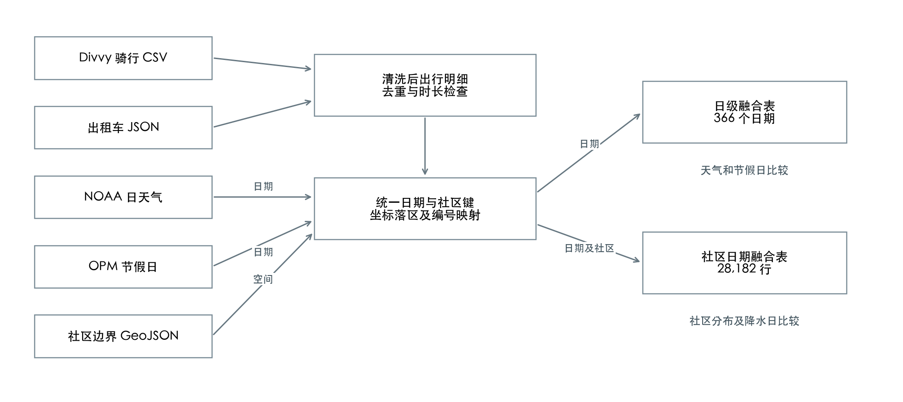
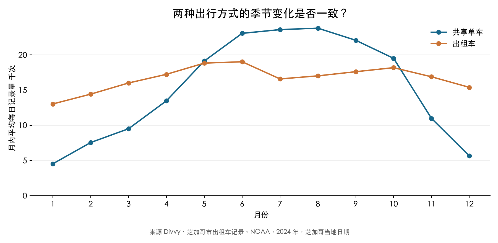
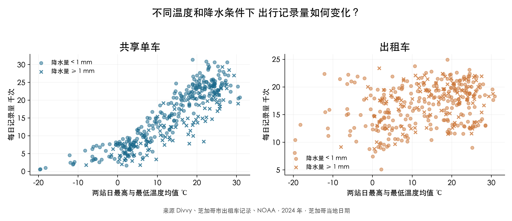
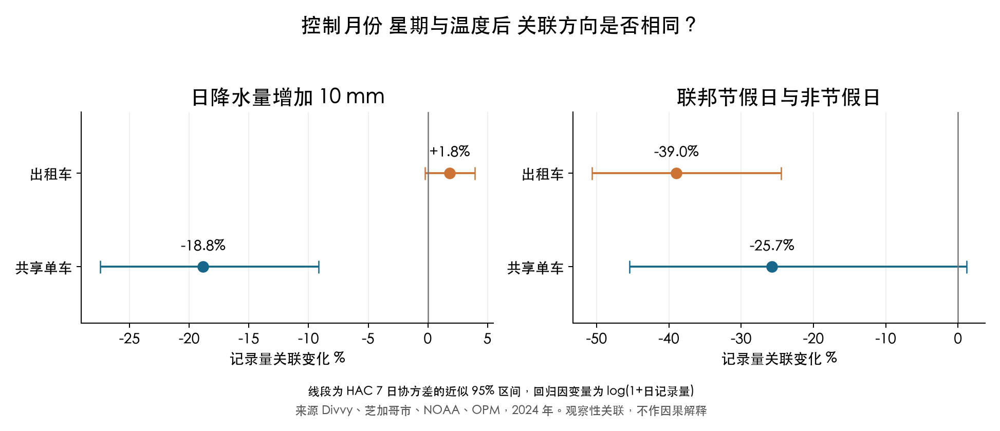
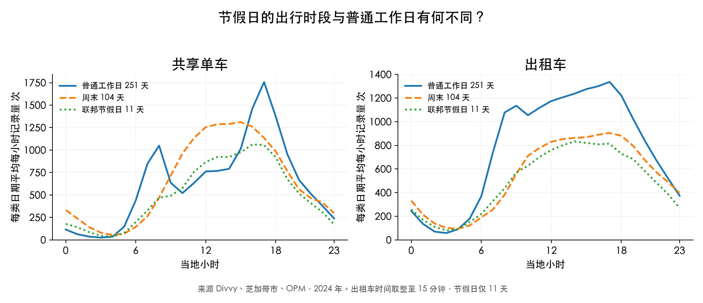
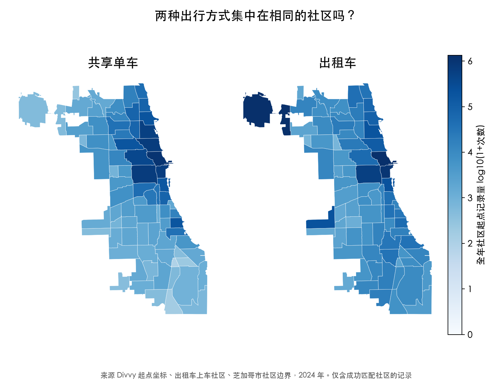
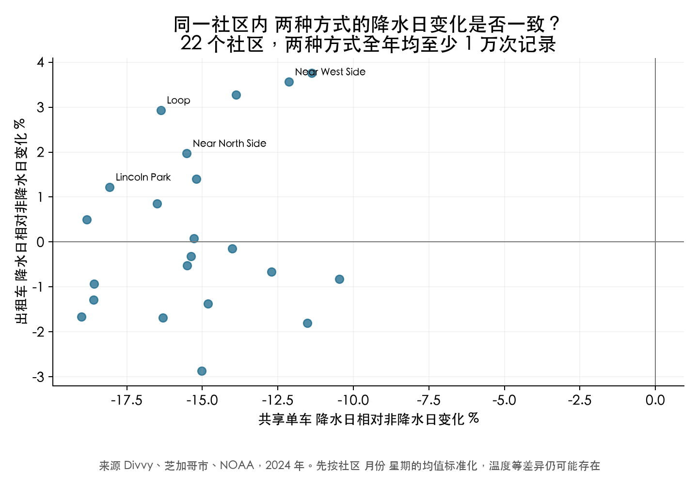
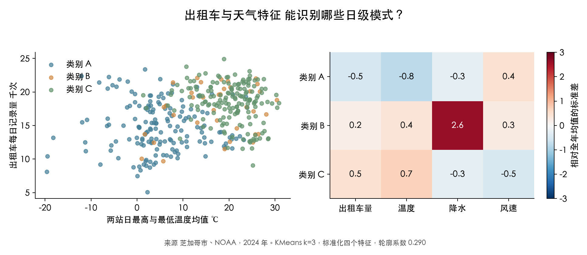

# 芝加哥天气和节假日与城市出行的关系

基于 2024 年共享单车 出租车 天气 日历与社区边界的多源数据分析

《大数据原理与应用》课程中期项目

## 研究范围与核心问题

本项目将两个运营数据源与天气、日历和地理边界关联，分析芝加哥 2024 年全年出行记录。Divvy 原始运营记录 5,860,568 条，原始出租车记录 6,480,350 条。Divvy 中含滑板车，分析仅保留普通和电助力单车。融合后的日级表覆盖 366 天。

研究问题一是降水和温度与两种出行方式的日记录量有什么关系。问题二是联邦节假日与普通工作日的出行量和小时分布有何差异。问题三是两种方式的社区分布及社区内降水日变化是否一致。三个问题分别需要运营记录与天气、日历或社区边界共同回答，单一来源无法完成这些比较。

记录量表示各公开系统实际收录的出行次数，不能等同于全市居民的全部需求。两种出行记录没有共同乘客 ID，因此本项目研究共同变化，不能识别个体在两种方式之间的替代。

主要结果中，日降水量增加 10 mm 对应的单车记录量关联变化为 -18.8%（近似 95% 区间 -27.5% 至 -9.2%），出租车为 +1.8%（近似 95% 区间 -0.2% 至 +3.9%）。这些估计来自控制月份、星期、温度与风速的观察性比较。

## 数据来源与实际规模

| 数据 | 发布者 | 获取及范围 | 关联字段 |
| --- | --- | --- | --- |
| 共享单车 | Divvy / Lyft | 2024 全年月度 CSV | 开始日期 起点坐标 |
| 出租车 | 芝加哥市 | 2024 全年逐日 JSON API | 开始日期 社区编号 |
| 日天气 | NOAA NCEI | 两站 732 个站日观测 | 观测日期 |
| 联邦节假日 | 美国 OPM | 官方 2024 年表 11 天 | 日期 |
| 社区边界 | 芝加哥市 | 77 个社区 GeoJSON | 社区编号 点落区 |

按底层记录的形成过程识别四类独立信源：共享单车运营系统、出租车监管报送、NOAA 气象观测和 OPM 官方日历。社区边界另作地理辅助。Divvy 由 Lyft 运营发布，数据所有权归芝加哥市；其骑行记录与出租车记录由不同系统独立形成，不是同一底层数据的转载。数据形态覆盖运营明细文件、公开 API、官方网页与地理空间数据。

| 主要源 | 原始有效字节 | 十进制 GB | 占两主要源比例 |
| --- | --- | --- | --- |
| 共享单车 | 1,163,088,709 | 1.163 | 36.9% |
| 出租车 | 1,986,872,838 | 1.987 | 63.1% |

两主要源共 3.150 GB，即 2.934 GiB。两源均超过 200 MB，最大单源占比 63.1%。天气、日历和边界为规模较小的辅助数据，没有依靠它们补足总量。

有效规模按原 CSV 的实际记录字节扣除滑板车、无效年份和重复 ID，不计 CSV 表头；单车完整原文件 1.189 GB，计入规模的记录 5,716,020 条。出租车归档经原始 ID 与日期检查。分页缓存、ZIP 和衍生表不重复计算。JSON 包含字段名开销，不同格式与压缩方式会影响字节规模，因此同时提供记录数、原始校验值和采集记录。完整原始文件保存在本机，仓库保留样本、元数据和重建脚本。

## 清洗与跨源融合

图 1 多源数据关联与处理流程

先分别清洗两类出行明细，再按当地日期以及“当地日期、社区编号”聚合，最后连接天气和日历。聚合后的一对一连接避免将同一天的单车与出租车订单直接相乘。时间和空间是两个实际使用的关联维度。

Divvy 先排除 144,337 条非单车记录，再去除缺少 ID 或开始时间、非研究年份、重复 ID、时长缺失及不在 60 秒至 24 小时范围的记录。异常金额和里程仅置为空，不删除整次记录。单车起点以精确点落区匹配社区；出租车使用官方上车社区编号。空间未匹配记录保留在系统日级统计，只从社区分析中排除。日级总量包含社区未知或市域以外的部分起点，应解释为两个系统的有效记录量。

| 数据 | 原始条数 | 清洗后条数 | 保留率 | 社区匹配率 |
| --- | --- | --- | --- | --- |
| Divvy 来源 | 5,860,568 | 5,583,690 | 95.28% | 98.50% |
| 出租车 | 6,480,350 | 6,107,775 | 94.25% | 97.69% |

最终日级表 366 行、小时表 8,784 行、社区日级表 28,182 行。清洗条数与日级总量、小时总量相等；社区总量与清洗条数减去未匹配社区记录相等。完整排除原因保存在 cleaning_quality.json，连接对账保存在 integration_checks.json。

天气使用奥黑尔和中途机场两站，每天对有效观测求平均。温度是日最高与最低温的均值代理，降水日阈值为至少 1 mm，含降雪液态当量。两站天气无法代表每个社区的局地变化。出租车时间由发布者取整到 15 分钟，因此只比较小时和日级分布。

## 天气与出行的共同变化

图 2 两种方式月内平均每日记录量的季节变化

图 3 不同温度和降水条件下的日记录量

月均和散点图用于识别季节性，不能直接把冷暖季差异解释为温度造成的变化。为区分日历因素，补充一个简单回归：以 log(1＋日记录量) 为因变量，解释变量为每 10 mm 降水、温度一次项和二次项、风速、节假日标记、月份与星期类别。采用 7 日滞后的 Newey–West 协方差给出近似区间。

图 4 控制日历和天气变量后的关联估计

问题一的回答是：在上述控制条件下，每增加 10 mm 日降水，单车记录量的关联变化为 -18.8%（近似 95% 区间 -27.5% 至 -9.2%），出租车为 +1.8%（近似 95% 区间 -0.2% 至 +3.9%）。有效回归样本 366 天。区间包含零时，不能据此确定稳定的方向。

## 节假日与出行时段

图 5 普通工作日 周末与联邦节假日的平均小时分布

问题二的回答是：控制其他变量后，联邦节假日的单车记录量关联变化为 -25.7%（近似 95% 区间 -45.5% 至 +1.2%），出租车为 -39.0%（近似 95% 区间 -50.6% 至 -24.5%）。小时曲线按每类日期实际天数计算平均，避免把 11 个节假日的总量直接与大量工作日比较。

单车节假日估计的区间跨过零，方向尚不稳定；出租车估计区间全部位于零以下。样本内的工作日单车曲线有早晚峰，周末及节假日更多集中在日间，但不能据此推断每条记录的实际出行目的。

联邦节假日仅是统一日历标记，不能代表所有人的实际休假。全年仅 11 个节假日，小样本、旅游活动和未观测事件都会影响结果，不能将差异推广到所有假期。

## 社区分布与降水日差异

图 6 两种方式在 77 个社区的全年起点分布

图 7 社区内按月份和星期标准化后的降水日比较

问题三的回答是：两种方式的社区分布存在可见差异。单车记录最多的三个社区为NEAR NORTH SIDE、NEAR WEST SIDE、LINCOLN PARK；出租车为OHARE、NEAR NORTH SIDE、LOOP。图中两幅地图使用同一 log10(1＋次数) 色标，显示的是记录量，不是人口校正后的出行率。

降水日比较仅保留两类全年记录都至少 1 万次的 22 个社区，先以社区、月份和星期对应的均值标准化。横纵轴分别是两种方式降水日与非降水日的相对差异。该比较仍可能受温度、可用车辆和未观测活动影响，不作社区层面的因果推断。

在这 22 个社区中，22 个社区的单车降水日指数低于非降水日；出租车有 10 个社区较高、12 个较低。两类系统的样本内变化并不一致，也不能证明同一批人由单车转乘出租车。

## 联合特征的简单聚类

图 8 出租车与天气联合特征的 KMeans 聚类

数据挖掘环节使用标准化后的出租车日量、温度、降水和风速四个特征做 KMeans，固定 k＝3、随机种子 42、20 次初始化。轮廓系数为 0.290。类别按平均温度排序命名 A、B、C，便于解释，不将类别视为客观存在的出行人群。结合 Divvy 许可的使用范围，聚类步骤只使用市政府出租车数据与 NOAA 天气，单车用于常规统计比较。

| 类别 | 天数 | 出租车日均 次 | 温度 ℃ | 降水 mm | 风速 m/s |
| --- | --- | --- | --- | --- | --- |
| 类别 A | 162 | 14,759 | 4.9 | 0.9 | 5.0 |
| 类别 B | 36 | 17,404 | 17.0 | 18.2 | 4.7 |
| 类别 C | 168 | 18,395 | 20.2 | 0.7 | 3.6 |

聚类在同一组数据上进行探索，没有独立测试集，也不用于预测性能评价。类别分离的一部分来自季节性与所选特征，不能根据聚类直接判断某种天气造成了某种行为。

## 结论 局限与复现

本项目通过日期关联、社区编号映射与单车坐标落区，构建了可以共同分析的多源数据体系，并回答了天气、节假日和社区差异三个问题。分析刻意采用分组统计、简单回归和聚类，主要工程工作集中在真实数据获取、清洗记录和连接对账。

局限包括：公开运营记录不覆盖全部交通方式，出租车存在未报送记录，两个机场站的天气只是城市代理，社区未按人口或车辆供应量校正，节假日样本较少，观察性关联仍有未观测混杂。两类记录中出现相反变化，也不能证明同一批人发生了方式替代。

复现顺序为采集、清洗融合、分析、规模检查。完整命令位于 README.md。原始文件的 SHA-256、字节数和采集日志可核对采集快照；历史源若发生修订，结果可能变化。仓库交付代码、代表性样本、完整融合表、图表和元数据，不上传完整原始运营数据。

## AI 使用说明

项目从 2026 年 11 月 10 日起使用 OpenAI Codex，参与选题、数据源核查、采集与清洗代码、分析、可视化及材料整理。当前会话没有提供可核验的底层模型版本字符串，因此未推测填写。代表性指令是“定一个选题然后目标是完成，不用太复杂的”，据此采用公开数据、明确的日期和社区键，以及简单统计与聚类。

采用了 AI 起草的代码框架，但根据真实字段与许可修改了方案：将单车会员与出租车支付方式分列，排除滑板车，将聚类限定为出租车与天气，并为不稳定传输增加分页缓存。核验方式包括官方逐月 count 对账、SHA-256、独立流式字节核算与数据框清洗结果比较，以及清洗明细与各聚合层总量对账。图表和本报告的数字均读取运行结果。

AI 提高了接口查找和初稿实现的效率，也把较多工作转向了字段语义、范围与结果核验。实际问题包括证书链、网络中断、源文件跨月、时间精度及来源名称与真实车型不完全一致，均据原始数据或官方说明修正。完整代表指令、采用和放弃情况、错误与反思见 AI_USAGE.md；本项目没有把程序检查写成学生人工审核经历，成员仍需理解核心逻辑并对最终提交内容负责。

## 数据来源

[1] Divvy 数据及许可 https://divvybikes.com/system-data

[2] 芝加哥 Taxi Trips 2024 https://data.cityofchicago.org/d/ajtu-isnz

[3] NOAA 日汇总数据 https://www.ncei.noaa.gov/access/search/data-search/daily-summaries/

[4] OPM 联邦节假日 https://www.opm.gov/policy-data-oversight/pay-leave/federal-holidays/

[5] 芝加哥社区边界 https://data.cityofchicago.org/d/igwz-8jzy

## 代码与数据复现

代码仓库 https://github.com/zicheng-yu/chicago-mobility-midterm（私有，评阅人需授权）
